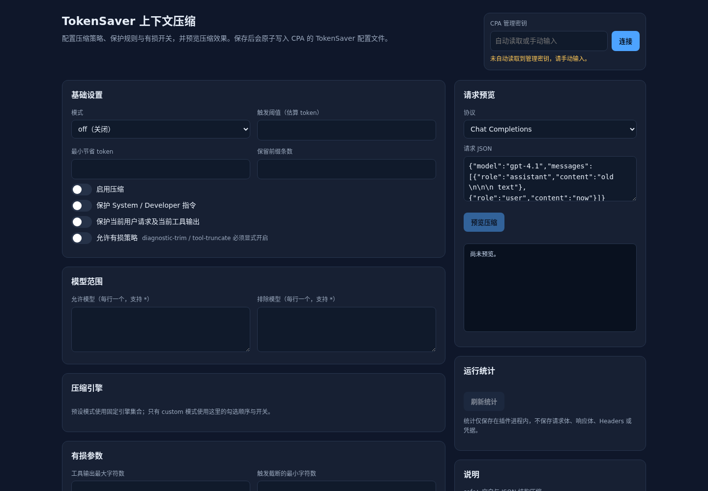
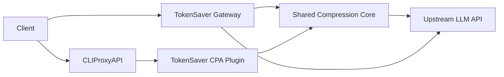

# TokenSaver

**Deterministic, fail-open context compression for LLM APIs.**

TokenSaver reduces redundant context before requests reach an upstream model. It ships as a shared Go compression core, a CLIProxyAPI plugin, and a standalone HTTP gateway. It does not call an LLM, does not require a database, and never needs access to provider credentials.

[](https://go.dev/)
[](LICENSE)
[](#project-status)

> **Status:** experimental. The compressor is intentionally conservative and fail-open, but lossy engines and prompt-cache effects must be evaluated against your own traffic before production use.



## Why TokenSaver

Long agent sessions accumulate tool output, logs, JSON payloads, and repeated context. Sending all of it on every turn is expensive. TokenSaver applies deterministic, local transformations to older context while preserving the parts that must not change:

- system and developer instructions;
- the current user turn and current tool results;
- tool-call IDs, tool names, arguments, and result linkage;
- JSON schemas and structured-output configuration;
- reasoning, encrypted, cache-control, and unknown multimodal fields;
- unsupported or malformed bodies, which pass through unchanged.

The default mode is **safe** and **lossless**. Lossy engines require an explicit `allow_lossy=true`.

## Features

- **One shared core** for OpenAI Chat Completions, OpenAI Responses/Codex, and Anthropic Messages.
- **Five deterministic engines**
  - `whitespace`: trims redundant whitespace while preserving fenced code blocks;
  - `json-minify`: compacts valid JSON tool output;
  - `exact-dedup`: removes adjacent, identical, non-tool messages;
  - `diagnostic-trim`: trims verbose logs while retaining error/warning lines;
  - `tool-truncate`: keeps head and tail of very large old tool output.
- **Fail-open by design**: parse errors, unsupported shapes, or compression errors return the original body.
- **No model calls, no database, no external service**.
- **CPA plugin** with `request_interceptor` and `management_api` capabilities.
- **Management UI** for configuration, request preview, and in-process statistics.
- **Standalone gateway** for Agent2API-style HTTP deployments.
- **Bounded in-memory stats**: no request bodies, headers, credentials, or model output are retained.

## Architecture



The core is deliberately independent of any host runtime. The CPA adapter and the HTTP gateway only translate host request/response shapes into the shared core.

See [docs/architecture.md](docs/architecture.md) for the full request flow and protection rules.

## Documentation

- [Architecture](docs/architecture.md)
- [Configuration](docs/configuration.md)
- [Deployment](docs/deployment.md)
- [Compatibility](docs/compatibility.md)
- [Cache strategy](docs/cache-strategy.md)
- [Testing](docs/testing.md)
- [Benchmarks](docs/benchmarks.md)
- [Limitations](docs/limitations.md)

## Quick Start

### Requirements

- Go 1.22 or newer;
- a C toolchain when building the CPA plugin (`CGO_ENABLED=1`);
- Linux for the supplied `.so` artifacts (AMD64 and ARM64 builds are included).

### Test and validate

```bash
go test ./... -count=1
go test ./... -count=1 -race -timeout=90s
go vet ./...
scripts/check_configs.sh
```

### Run the standalone gateway

```bash
go run ./cmd/tokensaver -config config/gateway.example.json -check
go run ./cmd/tokensaver -config config/gateway.example.json
```

The example gateway listens on `127.0.0.1:9231` and forwards to a local upstream. It does not open a public port.

### Build the CPA plugin

```bash
CGO_ENABLED=1 go build \
  -buildmode=c-shared \
  -trimpath \
  -ldflags='-s -w' \
  -o tokensaver-cpa.so \
  ./cmd/cpaplugin
```

Prebuilt artifacts are available in `dist/linux-amd64/` and `dist/linux-arm64/`.

## Configuration

The core configuration is shared by both adapters:

```json
{
  "enabled": true,
  "mode": "safe",
  "threshold_tokens": 512,
  "min_savings_tokens": 16,
  "preserve_prefix_items": 1,
  "preserve_last_user": true,
  "protect_system": true,
  "allow_lossy": false,
  "model_allow": ["*"],
  "model_deny": [],
  "engines": [
    {"id": "whitespace", "enabled": true},
    {"id": "json-minify", "enabled": true},
    {"id": "exact-dedup", "enabled": false},
    {"id": "diagnostic-trim", "enabled": false},
    {"id": "tool-truncate", "enabled": false}
  ],
  "tool_truncate": {
    "max_chars": 8000,
    "head_pct": 0.6,
    "tail_pct": 0.3,
    "min_chars": 9000
  },
  "diagnostic_trim": {
    "max_lines": 140,
    "min_chars": 12000,
    "preserve_error_lines": true
  },
  "logging": {
    "enabled": true,
    "max_entries": 500,
    "include_model": true,
    "include_engine": true
  }
}
```

See [docs/configuration.md](docs/configuration.md) for every field, preset mode, and import/export example.

## CPA Plugin

### Layout

Keep the plugin directory read-only and mount a separate writable data directory for configuration persistence:

```text
/CLIProxyAPI/plugins/linux/amd64/tokensaver-context-compression.so
/CLIProxyAPI/tokensaver-data/core.json
```

Example Compose mounts:

```yaml
volumes:
  - ./plugins:/CLIProxyAPI/plugins:ro
  - ./tokensaver-data:/CLIProxyAPI/tokensaver-data:rw
```

Example CPA configuration:

```yaml
plugins:
  enabled: true
  dir: plugins
  configs:
    tokensaver-context-compression:
      enabled: true
      priority: 100
      config_path: /CLIProxyAPI/tokensaver-data/core.json
```

`config_path` must be absolute and writable. The plugin directory itself should stay read-only.

### Management UI and API

The plugin registers:

```text
GET  /v0/management/tokensaver/config
PUT  /v0/management/tokensaver/config
POST /v0/management/tokensaver/preview
GET  /v0/management/tokensaver/stats
GET  /v0/resource/plugins/tokensaver-context-compression/ui
```

The UI reads the CPA management key from the CPA management page when possible, or asks for it manually. The key is never written to TokenSaver configuration or logs.

The management UI supports:

- safe/balanced/aggressive/custom modes;
- per-engine toggles;
- model allow/deny lists;
- prefix and current-turn protection;
- lossy parameters;
- request preview before saving;
- in-process statistics.

## Prompt Cache and Cost Trade-off

Compression changes the request prefix. Providers that cache prompt prefixes can miss the cache when historical messages are rewritten.

Measured behavior on a long synthetic prefix:

- uncompressed, second identical request: cache hit observed;
- compressed, first request and a short retry window: cache miss;
- compressed, repeated identical request after cache rebuild: cache hit observed;
- multi-turn simulation: default low-threshold safe mode changed the prefix in 5 of 6 turns; a high threshold changed it in 0 of 6 turns.

**Recommendation:** for cache-sensitive workloads, keep the core disabled or use a high `threshold_tokens` so compression only runs near the model context limit. Do not enable lossy engines without evaluating output quality.

More detail: [docs/cache-strategy.md](docs/cache-strategy.md).

## Project Layout

```text
cmd/
  cpaplugin/       CLIProxyAPI C ABI plugin
  tokensaver/      standalone HTTP gateway
  bench/           benchmark runner
  adaptercompare/  compare core/CPA/gateway behavior
pkg/
  core/            shared compression core
  adapters/        CPA request/response mapping
  gateway/         HTTP gateway and management API
config/            example configuration
docs/              architecture, configuration, deployment
tests/             integration and fixture tests
dist/              prebuilt AMD64/ARM64 artifacts
licenses/          third-party notices
```

## Development

```bash
make test
make race
make config
make bench
```

`make build` builds the standalone gateway. The CPA plugin requires a matching C toolchain and `CGO_ENABLED=1`.

Useful checks:

```bash
go vet ./...
scripts/check_configs.sh
python3 scripts/check_delivery.py
```

## Security

- No credentials are required by the compression core.
- The CPA plugin does not read provider auth files.
- The gateway forwards end-to-end headers but strips hop-by-hop headers and its own management headers.
- Unsupported or invalid request bodies are passed through unchanged.
- Management endpoints must be protected by the host’s management authentication.
- Never commit API keys, management keys, private keys, or production configuration.

For security issues, open a private GitHub security advisory rather than a public issue.

## Compatibility

- CLIProxyAPI v8.0.60 / schema version 10: tested at the C ABI and request-interceptor level.
- OpenAI Chat Completions, OpenAI Responses/Codex, and Anthropic Messages: request-shape coverage.
- SSE and streaming passthrough: gateway path covered.
- Agent2API: supported through the standalone HTTP gateway, not an in-process plugin.

Provider tokenizers, cache behavior, and model-specific request validation vary. Validate against your own upstream and version before enabling compression.

## Limitations

- Token counts are deterministic estimates, not provider billing values.
- Lossy engines can remove information required by later turns.
- Prompt-cache behavior is provider-specific and can be affected by prefix changes.
- The project does not manage provider accounts, quotas, routing, or credentials.
- Long-running high-concurrency and failure-injection tests are not part of the default test suite.
- Windows/macOS plugin builds are not provided; the prebuilt artifacts target Linux AMD64/ARM64.

## License

MIT. See [LICENSE](LICENSE) and [licenses/THIRD_PARTY_NOTICES.md](licenses/THIRD_PARTY_NOTICES.md).

## Contributing

Issues and pull requests are welcome. Please:

1. keep changes focused and fail-open;
2. add tests for new compression or protocol behavior;
3. run `go test ./...`, `go test -race ./...`, and `go vet ./...`;
4. avoid committing generated caches, local configuration, credentials, or deployment data.

---

## 中文简介

TokenSaver 是一个面向 LLM API 的确定性上下文压缩工具，提供共享压缩 Core、CLIProxyAPI 插件和独立 HTTP 网关。默认 safe 模式不调用模型、不需要数据库、失败时原样透传；有损策略必须显式开启。

压缩会改变历史前缀，因此对 prompt cache 敏感的场景应保持关闭或使用较高阈值。详细配置和部署说明见 `docs/`。
