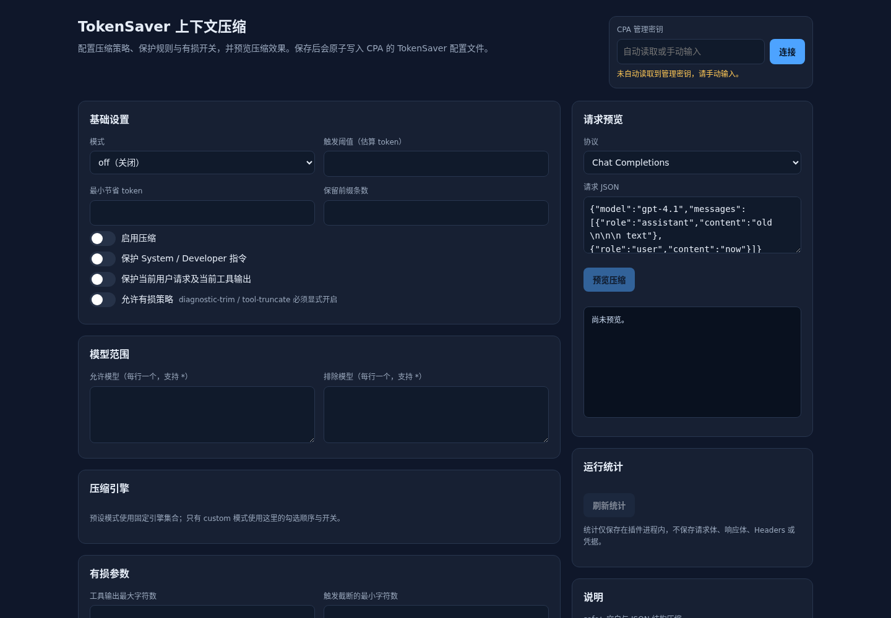
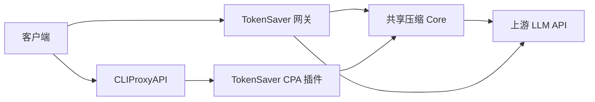

# TokenSaver

**面向 LLM API 的确定性、fail-open 上下文压缩工具。**

TokenSaver 会在请求到达上游模型前减少冗余上下文。它由共享 Go 压缩 Core、CLIProxyAPI 插件和独立 HTTP 网关组成，不调用 LLM、不依赖数据库，也不需要访问 Provider 凭据。

[English](README.md) | [简体中文](README.zh-CN.md)

[](https://go.dev/)
[](LICENSE)
[](#项目状态)

## 项目状态

> **项目状态：** 实验性。压缩器刻意保持保守并采用 fail-open，但有损引擎和 prompt cache 影响必须在你自己的流量上验证后再用于生产。



## 为什么需要 TokenSaver

长时间运行的 Agent 会话会积累工具输出、日志、JSON payload 和重复上下文。每一轮都完整发送这些内容成本很高。TokenSaver 对较早的上下文执行确定性的本地转换，同时保护不能改变的部分：

- System 和 Developer 指令；
- 当前用户轮次及当前工具结果；
- tool-call ID、工具名、参数及调用/结果对应关系；
- JSON Schema 和结构化输出配置；
- reasoning、加密字段、cache-control 及未知多模态字段；
- 不支持或格式错误的请求体，原样透传。

默认模式是 **safe** 且 **无损**。有损引擎必须显式设置 `allow_lossy=true`。

## 功能

- **一个共享 Core**，支持 OpenAI Chat Completions、OpenAI Responses/Codex 和 Anthropic Messages。
- **五个确定性引擎**
  - `whitespace`：清理冗余空白，同时保留 fenced code block；
  - `json-minify`：压缩合法的 JSON 工具输出；
  - `exact-dedup`：删除相邻、相同且非工具的重复消息；
  - `diagnostic-trim`：缩减冗长日志，同时保留错误/警告行；
  - `tool-truncate`：对超大的旧工具输出保留头部和尾部。
- **Fail-open**：解析失败、不支持的请求形状或压缩异常时返回原始 body。
- **不调用模型、不需要数据库、不依赖外部服务**。
- **CPA 插件**：声明 `request_interceptor` 和 `management_api` 能力。
- **管理页**：配置、请求预览和进程内统计。
- **独立网关**：适用于 Agent2API 风格的 HTTP 部署。
- **有界内存统计**：不保存请求体、Headers、凭据或模型输出。

## 架构



Core 刻意不依赖任何宿主运行时。CPA Adapter 和 HTTP 网关只负责把宿主请求/响应形状转换成共享 Core 的输入。

完整请求流和保护规则见 [docs/architecture.md](docs/architecture.md)。

## 文档

- [架构](docs/architecture.md)
- [配置](docs/configuration.md)
- [部署](docs/deployment.md)
- [兼容性](docs/compatibility.md)
- [缓存策略](docs/cache-strategy.md)
- [测试](docs/testing.md)
- [基准测试](docs/benchmarks.md)
- [限制](docs/limitations.md)

## 快速开始

### 环境要求

- Go 1.22 或更高版本；
- 构建 CPA 插件时需要 C 工具链（`CGO_ENABLED=1`）；
- 仓库提供的 `.so` 制品面向 Linux（包含 AMD64 和 ARM64）。

### 测试与校验

```bash
go test ./... -count=1
go test ./... -count=1 -race -timeout=90s
go vet ./...
scripts/check_configs.sh
```

### 运行独立网关

```bash
go run ./cmd/tokensaver -config config/gateway.example.json -check
go run ./cmd/tokensaver -config config/gateway.example.json
```

示例网关监听 `127.0.0.1:9231`，并转发到 `config/gateway.example.json` 中配置的 upstream。使用自己的上游时：

1. 复制示例配置；
2. 把 `upstream` 改成你的 OpenAI-compatible base URL；
3. 除非有私有网络或反向代理，否则保持监听在 loopback。

```bash
cp config/gateway.example.json /tmp/tokensaver-gateway.json
# 编辑 /tmp/tokensaver-gateway.json，设置 "upstream"
go run ./cmd/tokensaver -config /tmp/tokensaver-gateway.json -check
go run ./cmd/tokensaver -config /tmp/tokensaver-gateway.json
```

通过网关发送普通请求。客户端继续携带自己的 Provider 凭据；TokenSaver 不需要这些凭据。

```bash
curl http://127.0.0.1:9231/v1/chat/completions \
  -H "Authorization: Bearer $UPSTREAM_API_KEY" \
  -H "Content-Type: application/json" \
  -d '{
    "model": "your-model",
    "messages": [
      {"role": "assistant", "content": "old  \n\n\n text"},
      {"role": "user", "content": "Reply with OK."}
    ]
  }'
```

如果压缩生效，网关响应会包含：

```text
X-TokenSaver-Applied: true
X-TokenSaver-Savings-Percent: <value>
```

示例网关不会开放公网端口。

### 构建 CPA 插件

```bash
CGO_ENABLED=1 go build \
  -buildmode=c-shared \
  -trimpath \
  -ldflags='-s -w' \
  -o tokensaver-cpa.so \
  ./cmd/cpaplugin
```

预构建制品位于 `dist/linux-amd64/` 和 `dist/linux-arm64/`。

## 配置

两个 Adapter 共用同一份 Core 配置：

```json
{
  "enabled": true,
  "mode": "safe",
  "threshold_tokens": 512,
  "min_savings_tokens": 16,
  "preserve_prefix_items": 1,
  "preserve_last_user": true,
  "protect_system": true,
  "allow_lossy": false,
  "model_allow": ["*"],
  "model_deny": [],
  "engines": [
    {"id": "whitespace", "enabled": true},
    {"id": "json-minify", "enabled": true},
    {"id": "exact-dedup", "enabled": false},
    {"id": "diagnostic-trim", "enabled": false},
    {"id": "tool-truncate", "enabled": false}
  ],
  "tool_truncate": {
    "max_chars": 8000,
    "head_pct": 0.6,
    "tail_pct": 0.3,
    "min_chars": 9000
  },
  "diagnostic_trim": {
    "max_lines": 140,
    "min_chars": 12000,
    "preserve_error_lines": true
  },
  "logging": {
    "enabled": true,
    "max_entries": 500,
    "include_model": true,
    "include_engine": true
  }
}
```

每个字段、预设模式和导入/导出示例见 [docs/configuration.md](docs/configuration.md)。

## CPA 插件

### 目录布局

插件目录保持只读，另外挂载一个可写数据目录用于配置持久化：

```text
/CLIProxyAPI/plugins/linux/amd64/tokensaver-context-compression.so
/CLIProxyAPI/tokensaver-data/core.json
```

Compose 挂载示例：

```yaml
volumes:
  - ./plugins:/CLIProxyAPI/plugins:ro
  - ./tokensaver-data:/CLIProxyAPI/tokensaver-data:rw
```

CPA 配置示例：

```yaml
plugins:
  enabled: true
  dir: plugins
  configs:
    tokensaver-context-compression:
      enabled: true
      priority: 100
      config_path: /CLIProxyAPI/tokensaver-data/core.json
```

`config_path` 必须是绝对路径且可写。插件目录本身应保持只读。

### CPA 分步安装

以下步骤假设 CLIProxyAPI 部署目录包含 `docker-compose.yml` 和 `config.yaml`。

```bash
cd /path/to/cliproxyapi

mkdir -p plugins/linux/amd64 tokensaver-data

# 复制与 CPA 容器架构匹配的制品
install -m 755 /path/to/tokensaver-cpa.so \
  plugins/linux/amd64/tokensaver-context-compression.so

# 先使用 safe 示例配置
install -m 600 /path/to/tokensaver/config/core.example.json \
  tokensaver-data/core.json
```

在 `docker-compose.yml` 中增加只读插件挂载和可写数据挂载：

```yaml
volumes:
  - ./plugins:/CLIProxyAPI/plugins:ro
  - ./tokensaver-data:/CLIProxyAPI/tokensaver-data:rw
```

在 `config.yaml` 中增加或合并插件配置：

```yaml
plugins:
  enabled: true
  dir: plugins
  configs:
    tokensaver-context-compression:
      enabled: true
      priority: 100
      config_path: /CLIProxyAPI/tokensaver-data/core.json
```

重建容器。挂载发生变化时，单纯 restart 不够：

```bash
docker compose up -d --force-recreate cli-proxy-api
```

检查插件是否加载：

```bash
docker logs --since 5m cli-proxy-api 2>&1 | grep -Ei 'tokensaver|pluginhost'
```

预期日志包含：

```text
pluginhost: plugin loaded plugin_id=tokensaver-context-compression
pluginhost: plugin registered plugin_id=tokensaver-context-compression
```

### 管理页与管理 API

插件注册：

```text
GET  /v0/management/tokensaver/config
PUT  /v0/management/tokensaver/config
POST /v0/management/tokensaver/preview
GET  /v0/management/tokensaver/stats
GET  /v0/resource/plugins/tokensaver-context-compression/ui
```

管理页会尽量复用 CPA 管理页保存的管理密钥；读不到时要求手动输入。密钥不会写入 TokenSaver 配置或日志。

管理页支持：

- safe/balanced/aggressive/custom 模式；
- 单引擎开关；
- 模型 allow/deny 列表；
- 前缀和当前轮次保护；
- 有损参数；
- 保存前请求预览；
- 进程内统计。

### 打开管理页

使用 CPA 管理页的主机和端口，打开：

```text
/v0/resource/plugins/tokensaver-context-compression/ui
```

页面会尝试复用 CPA 管理页保存的管理密钥。如果读不到，手动粘贴 CPA 管理密钥。密钥只在请求期间保存在内存中，不写入 TokenSaver 配置。

建议首次使用顺序：

1. 先保持 `enabled=false`，检查配置；
2. 加载配置；
3. 用合成请求执行 **预览**；
4. 检查 `applied`、`engines`、`first_changed_item` 和节省率；
5. 保存配置；
6. 通过 CPA 发送测试请求；
7. 打开 **运行统计**，确认 `count` 和 `applied` 增长；
8. 评估缓存/费用影响后再开启压缩。

### 验证插件

可以使用 CPA 管理密钥查询管理 API：

```bash
curl -sS \
  -H "Authorization: Bearer $CPA_MANAGEMENT_KEY" \
  http://<cpa-host>:<cpa-port>/v0/management/plugins
```

TokenSaver 条目应显示：

```text
configured=true
registered=true
enabled=true
effective_enabled=true
```

### 升级与回滚

升级前备份：

```text
config.yaml
docker-compose.yml
plugins/linux/amd64/tokensaver-context-compression.so
tokensaver-data/core.json
```

回滚时恢复这些文件并重建容器：

```bash
docker compose up -d --force-recreate cli-proxy-api
```

在确认不需要回滚前保留 `tokensaver-data/`。不要在普通插件升级中删除该目录。

## Prompt Cache 与成本权衡

压缩会改变请求前缀。对于缓存 prompt prefix 的 Provider，历史消息被改写时可能发生 cache miss。

在一个长合成前缀上的观测结果：

- 未压缩时，第二次相同请求观察到 cache hit；
- 压缩后，首次请求和短时间重试窗口内出现 cache miss；
- 缓存重建后，重复相同压缩请求观察到 cache hit；
- 多轮模拟中，默认低阈值 safe 模式在 6 轮中有 5 轮改变前缀；高阈值模式为 0 轮。

**建议：** 对缓存敏感的工作负载保持 Core 关闭，或使用较高的 `threshold_tokens`，让压缩只在接近模型上下文上限时运行。未评估输出质量前不要开启有损引擎。

更多内容见 [docs/cache-strategy.md](docs/cache-strategy.md)。

## 项目结构

```text
cmd/
  cpaplugin/       CLIProxyAPI C ABI 插件
  tokensaver/      独立 HTTP 网关
  bench/           基准测试工具
  adaptercompare/  比较 Core/CPA/网关行为
pkg/
  core/            共享压缩 Core
  adapters/        CPA 请求/响应映射
  gateway/         HTTP 网关与管理 API
config/            示例配置
docs/              架构、配置、部署文档
tests/             集成测试与 fixture
dist/              预构建 AMD64/ARM64 制品
licenses/          第三方许可证与声明
```

## 开发

```bash
make test
make race
make config
make bench
```

`make build` 构建独立网关。CPA 插件需要匹配的 C 工具链和 `CGO_ENABLED=1`。

常用检查：

```bash
go vet ./...
scripts/check_configs.sh
python3 scripts/check_delivery.py
```

## 安全

- 压缩 Core 不需要任何凭据。
- CPA 插件不读取 Provider auth 文件。
- 网关转发端到端 Headers，但会剔除 hop-by-hop Headers 和自身管理 Headers。
- 不支持或非法的请求体原样透传。
- 管理端点必须由宿主的鉴权机制保护。
- 永远不要提交 API key、管理密钥、私钥或生产配置。

安全问题请通过 GitHub 私有 security advisory 报告，不要开公开 issue。

## 兼容性

- CLIProxyAPI v8.0.60 / schema version 10：已在 C ABI 和 request interceptor 层验证。
- OpenAI Chat Completions、OpenAI Responses/Codex、Anthropic Messages：覆盖请求形状。
- SSE 和流式透传：网关路径已覆盖。
- Agent2API：通过独立 HTTP 网关支持，不是进程内插件。

不同 Provider 的 tokenizer、缓存行为、模型请求校验可能不同。启用压缩前请在你自己的上游和版本上验证。

## 限制

- Token 数是确定性估算，不是 Provider 账单值。
- 有损引擎可能删除后续轮次仍需的信息。
- Prompt cache 行为依赖 Provider，可能受前缀变化影响。
- 本项目不管理 Provider 账号、额度、路由或凭据。
- 默认测试集不包含长时间高并发和故障注入测试。
- 不提供 Windows/macOS 插件构建；预构建制品面向 Linux AMD64/ARM64。

## 故障排查

### CPA 中看不到插件

检查：

```bash
docker inspect cli-proxy-api --format '{{json .Mounts}}'
docker logs --since 10m cli-proxy-api 2>&1 | grep -Ei 'plugin|tokensaver'
```

确认：

- `.so` 与 CPA 容器架构一致；
- 插件位于宿主 `plugins/linux/<arch>/` 目录；
- 插件目录已挂载；
- CPA `plugins.enabled` 和插件 `enabled` 都为 true；
- 插件 schema 与 CPA 版本兼容。

### 管理页要求输入密钥

页面无法从浏览器存储读取 CPA 管理密钥。手动粘贴 CPA 管理密钥即可。该密钥不会写入 TokenSaver 配置。

### 保存配置失败

`config_path` 必须指向可写挂载中的可写文件。插件目录本身应保持只读；请使用独立的 `tokensaver-data/` 挂载。

### 请求没有变化

检查运行统计和 `skipped_reason` 字段。常见原因：

- `enabled=false` 或 `mode=off`；
- 请求低于 `threshold_tokens`；
- 模型被 `model_allow` / `model_deny` 排除；
- 不支持的 JSON 形状或非法 JSON；
- 选中引擎执行后没有有效变化；
- 节省量低于 `min_savings_tokens`。

### 缓存命中率下降

压缩会改变请求前缀。见 [docs/cache-strategy.md](docs/cache-strategy.md)，并考虑提高阈值或对缓存敏感流量保持压缩关闭。

## 许可证

MIT。见 [LICENSE](LICENSE) 和 [licenses/THIRD_PARTY_NOTICES.md](licenses/THIRD_PARTY_NOTICES.md)。

## 贡献

欢迎 issue 和 pull request。请：

1. 保持改动聚焦并遵循 fail-open；
2. 为新的压缩或协议行为增加测试；
3. 运行 `go test ./...`、`go test -race ./...` 和 `go vet ./...`；
4. 不要提交生成缓存、本地配置、凭据或部署数据。

---

[English README](README.md)
